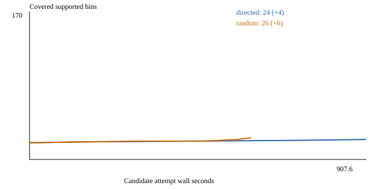

# Native random stimulus

The profile is generated from `../platform.json` with
`scripts/riscv-dv-project.py`. See the VexRiscv random example and
`scripts/riscv-dv/README.md` for setup. Select the private checkout through the
project's `core.source_repo`. Set `core.lock` and `RVW_VEX_LOCK` to `vex-dv`.
Set `VEXIIRISCV` to that checkout. Use `nice -n 10`.

```sh
rvw --project examples/vexiiriscv/rvw.toml regress random \
  --settings examples/vexiiriscv/rvw/random/random.toml \
  --seed-base 49 --seeds 1 --out NEW_DIRECTORY --json
```

## Measured results

On 2026-11-13, seed 48 passed C1 and matched all 125 retired instructions with
Spike. Seed 49, with software scratch initialization, passed C1 and matched all
113 retired instructions. Both comparisons were strict, complete and nonempty.
Neither used masks or synchronization. Neither trace has CSR snapshots.
The configuration is RV32IM at core revision `9f70315d`.

The [measurement record](native-2026-11-13.json) retains both results and hashes.
Raw artifacts remain at its recorded paths. The tools worktree was dirty.
These bounded results do not establish full ISA, CSR-state, formal, physical or
C4 acceptance. The extra instruction initializes `mscratch` before the GPR setup.
It fixes the undefined-input mismatch found by the VexRiscv campaign.

Artifact paths in the JSON are relative to the workstation root.

## Paired native closure sample

Both arms start from the same four-program suite with 20 supported bins hit.
Each arm runs four candidates with seed base 1. Strict Spike checks qualify
each candidate before it earns coverage. The directed arm reaches 24 bins.
The uniform random arm reaches 26 bins. The supported denominator is 170.
The full declared ISA plan has 4,544 bins.



See [the curves](paired-native/curves.json) and
[the measurements](paired-native/measurements.json). Candidate wall times are
907.6 seconds for directed and 597.2 seconds for random.
They include lock waits. They exclude initial-suite checks and evidence
publication. This single seed and four-attempt budget show no gain over random.
They do not qualify CPU-hour rates or the broader #349 and #353 goals.
The recorded campaign status remains inconclusive. Resume preserved the hit
set. See the measurement record for archived replay availability.

For new private runs, set `RVW_SBT_LOCK=sbt-dv` as well as the private core
lock. The launcher uses that lock for build output in this worktree.

See [the native source coverage sample](source-coverage/README.md) for line/toggle
counts, functional source links, native holes and measured suite guidance.
