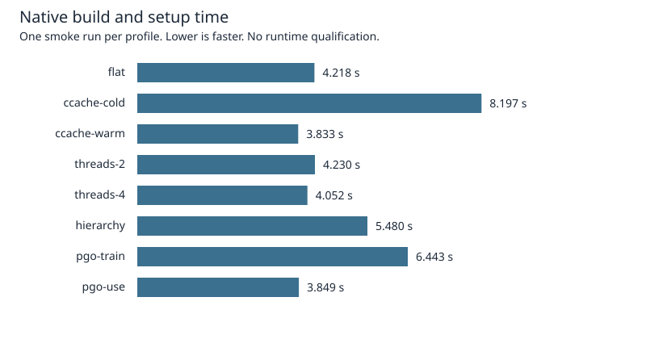

# Native Verilator profile smoke

`campaign.py` builds and runs the same captured VexRiscv RTL and ELF with each
profile in `plan.json`. It uses a fresh process for every profile. It records
build/setup time, execution plus C2 publication time, maximum child-process RSS,
ccache counters and complete C2 hashes. All native work uses two build jobs
and `nice -n 10`. Run it under the private worker lock:

```sh
scripts/with-lock.sh vex-NAME nice -n 10 rvw/.venv/bin/python \
  examples/vexriscv/rvw/profiles/campaign.py --rtl /path/to/VexTop.v \
  --elf /path/to/smoke --reference-trace /path/to/reference/rvfi.jsonl \
  --out /path/to/new-profile-campaign
```

Install ccache and matching Clang/LLVM profile tools first. On macOS the probe
selects the active Xcode C++ driver and SDK. `RVW_NATIVE_CXX` can select another
installed C++ driver. Compiler PGO requires Clang-compatible instrumentation.
The profiler refuses unsupported inherited compiler and make flags. Its cache
uses a private directory and captured configuration. It does not read the
user's global ccache configuration.

## Recorded sample

On 2026-11-13, all eight profiles passed 17 instructions in 81 cycles with
seed 7. Every complete C2 file was byte-identical to the earlier independent
Arcilator reference. The native runtime archive is linked directly. Compiler
PGO includes all runtime units, including zero-count DPI functions. Missing or
outdated profile diagnostics remain errors. A first training path omitted an
unused runtime unit and was rejected. The archive linkage fixed that cause.

The final sample used macOS ARM64, Verilator 5.049, Apple Clang 21.0.0 and
ccache 4.14.3. [measurements.json](measurements.json) records source and input
hashes, exact counters and measurements.



| Profile | Build and setup s | Execution and trace ms | Child peak RSS MiB | Complete C2 equal |
|---|---:|---:|---:|---|
| flat | 13.790 | 1.564 | 208.3 | yes |
| ccache-cold | 15.221 | 1.753 | 208.9 | yes |
| ccache-warm | 4.429 | 1.772 | 129.9 | yes |
| threads-2 | 13.504 | 33.617 | 208.2 | yes |
| threads-4 | 11.631 | 447.705 | 207.7 | yes |
| hierarchy | 16.225 | 3.875 | 207.8 | yes |
| pgo-train | 6.114 | 2.507 | 216.9 | yes |
| pgo-use | 10.719 | 1.744 | 215.4 | yes |

The cold ccache sample took 15.221 s. The warm sample took 4.429 s and had
three direct hits and one miss. These are individual build observations.
Execution times are too short to qualify throughput. They include the Python
port bridge and trace output. Peak RSS is the maximum reported for child build
processes, not the total concurrent machine memory. No runtime optimization is
retained. Held-out workloads, long alternating trials, confidence intervals,
fresh winner confirmation, Scala/elaboration costs and BOOM presets were not
run. This sample does not close #74 or #344.

## Captured controls

`--build-profile` on `engine-probe.py` reads `rvw.native-build-profile/1`.
It supports threads, explicit hierarchy modules, ccache, compiler PGO capture
and compiler PGO reuse. Profile configuration, RTL, hierarchy control, SDK
settings, make rules, training ELF and profile bytes enter the build record.
The versioned binding rejects changed RTL, compiler, Verilator, SDK, make rules,
threads, hierarchy or profile digests before reuse. The scalar profile namespace
is `scalar-native-profile-v3`. `PROFOUTOFDATE` and compiler outdated/unprofiled
diagnostics fail the run. The original production Scala collector is unchanged.
These probe runs have no C4 cache key and cannot earn acceptance.

The hierarchy sample selects `StreamFifo` from this project's plan. It checks
external scalar port access through the generated hierarchy. It does not qualify
Spinal internal register/memory bridge access across hierarchy boundaries.
The captured launcher path is passed to hierarchical sub-builds. This avoids a
missing executable path in the installed relocatable tool wrapper.

## Decisions and limits

Defaults keep the flat build and no compiler profile. The experiment does not
change the production Spinal adapter or weaken its external-input refusals.
Compiler PGO is separate from Verilator thread-scheduling PGO. Thread PGO,
non-scalar ports, waves, internal checkpoint access and broader device timing
remain outside this experiment. The profile capture covers this probe's inputs.
It is not a complete portable compiler/SDK bundle or a C4 reuse identity.
