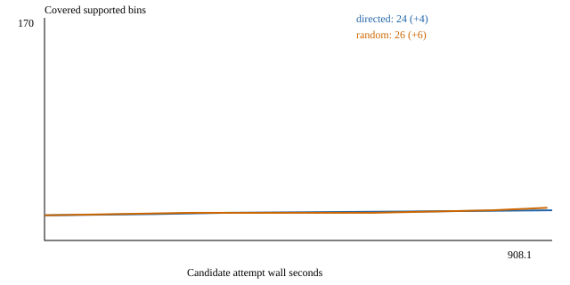

# Native random stimulus

`random.toml`, `link.ld` and `runtime/` are generated from `../platform.json`:

```sh
rvw/.venv/bin/python scripts/riscv-dv-project.py examples/vexriscv/rvw/platform.json --out NEW_DIRECTORY
```

Install the pinned generator as described in `scripts/riscv-dv/README.md`.
Use the private core checkout's installed project file. To run the in-place
example instead, set its local `core.source_repo` to the private checkout.
The `VEXRISCV` environment variable alone does not override runner selection.
Set both `core.lock` and `RVW_VEX_LOCK` to `vex-dv` for these private runs.
Use `nice -n 10`. Keep outputs inside this worktree or the private core copy.

```sh
rvw --project examples/vexriscv/rvw.toml regress random \
  --settings examples/vexriscv/rvw/random/random.toml \
  --seed-base 49 --seeds 1 --out NEW_DIRECTORY --json
```

## Measured results

On 2026-11-13, the revised seed 49 program passed C1. All 112 retired
instructions matched Spike under strict comparison. No masks or synchronization
were used. The trace includes the actual `mscratch` snapshot at every retirement.
The configuration is RV32IM at core revision `baf7dc82`.

The first seed 49 program exposed undefined `mscratch` reset storage. C1 passed,
but strict Spike comparison mismatched on `csr[0x340]` at order zero. The runtime
now writes `mscratch` before GPR initialization. This defines a software input.
The original failure remains in the [measurement record](native-2026-11-13.json).
An earlier seed 48 execution is inconclusive because the tools commit changed
during its launch. It earns no match count or coverage credit.

These results cover the bounded bare integer profile. They do not establish
full ISA, formal, physical or C4 acceptance. Raw C1, C2, ELF and reference artifacts
remain at the paths recorded in the JSON. The tools worktree was dirty. The JSON
pins the measured ELF, trace, runtime, platform and generated RTL hashes.

Artifact paths in the JSON are relative to the workstation root.

## Paired native closure sample

Both arms start from the same four-program suite with 20 supported bins hit.
Each arm runs four candidates with seed base 1. Strict Spike checks qualify
each candidate before it earns coverage. The directed arm reaches 24 bins.
The uniform random arm reaches 26 bins. The supported denominator is 170.
The full declared ISA plan has 4,544 bins.



See [the curves](paired-native/curves.json) and
[the measurements](paired-native/measurements.json). Candidate wall times are
908.1 seconds for directed and 899.4 seconds for random.
They include lock waits. They exclude initial-suite checks and evidence
publication. This single seed and four-attempt budget show no gain over random.
They do not qualify CPU-hour rates or the broader #349 and #353 goals.
The recorded campaign status remains inconclusive. Resume preserved the hit
set. See the measurement record for archived replay availability.

For new private runs, set `RVW_SBT_LOCK=sbt-dv` as well as the private core
lock. The launcher uses that lock for build output in this worktree.

See [the native source coverage sample](source-coverage/README.md) for line/toggle
counts, functional source links, native holes and measured suite guidance.
